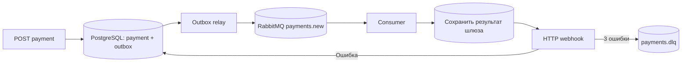

# MCC Basis

Сервис асинхронной обработки платежей: FastAPI принимает запрос, PostgreSQL сохраняет платёж и событие, RabbitMQ передаёт работу отдельному consumer, а consumer отправляет результат на webhook. Платёжный шлюз эмулируется: задержка 2–5 секунд, вероятность успеха 90%. Реальных списаний сервис не выполняет.

Стек: Python 3.12, FastAPI, Pydantic v2, асинхронный SQLAlchemy, PostgreSQL 16, RabbitMQ 4, FastStream, Alembic. API и consumer используют один Docker-образ; роли задаются командами запуска.

## Запуск

Нужны Docker Engine или Docker Desktop с Docker Compose v2.

```bash
cp .env.example .env
docker compose up --build -d
docker compose ps
```

В `.env` задаётся общий статический `API_KEY`. Значения в примере подходят для локальной демонстрации; перед внешним размещением задайте собственные ключ и пароли. API доступен по `http://localhost:8000`, RabbitMQ Management — по `http://localhost:15672`. Учётная запись RabbitMQ из примера: `mcc` / `mcc-local-password`. Оба опубликованных порта привязаны к `127.0.0.1`; PostgreSQL доступен только внутри сети Compose.

Миграции выполняются командой API перед запуском Uvicorn. Consumer стартует после готовности API и брокера. Данные PostgreSQL и RabbitMQ сохраняются в именованных Docker volumes.

```bash
docker compose logs -f api consumer
docker compose stop
docker compose up -d
```

`docker compose down` сохраняет данные. Добавление `--volumes` удалит базу и сообщения брокера.

## HTTP API

Каждый опубликованный endpoint, включая `/health`, `/docs` и `/openapi.json`, требует заголовок `X-API-Key`. Отсутствующий или неверный ключ возвращает `401`.

### Создать платёж

```bash
curl -i http://localhost:8000/api/v1/payments \
  -H 'X-API-Key: mcc-basis-local-demo-key' \
  -H 'Idempotency-Key: invoice-2026-001' \
  -H 'Content-Type: application/json' \
  --data '{
    "amount": "1500.00",
    "currency": "RUB",
    "description": "Оплата заказа 001",
    "metadata": {"order_id": "001"},
    "webhook_url": "https://example.com/payments/webhook"
  }'
```

`webhook_url` должен вести на ваш доступный HTTP(S) endpoint; URL в примере показывает формат. Внутри контейнера `localhost` указывает на сам контейнер. Для webhook на хосте Docker Desktop используйте `http://host.docker.internal:PORT/path`, а для сервиса в Compose — его имя в сети.

Ответ: `202 Accepted`.

```json
{
  "payment_id": "6ac4bca7-4705-4795-8f79-6335c57d794a",
  "status": "pending",
  "created_at": "2026-10-14T12:00:00Z"
}
```

| Поле | Правило |
| --- | --- |
| `amount` | Положительный Decimal, максимум 18 цифр всего и 2 после запятой; предел `9999999999999999.99`. Строка сохраняет точность денежного значения. |
| `currency` | `RUB`, `USD` или `EUR`. |
| `description` | Необязательная строка до 1000 символов; по умолчанию `""`. |
| `metadata` | Необязательный JSON-объект; по умолчанию `{}`. |
| `webhook_url` | Обязательный HTTP(S) URL до 2048 символов. |
| `Idempotency-Key` | Обязательный непустой HTTP-заголовок до 255 символов. |

Пропущенный `Idempotency-Key` или некорректные поля возвращают `422`. Неизвестные поля запроса тоже отклоняются.

Ключ идемпотентности уникален в базе. Повтор запроса с тем же ключом и тем же нормализованным телом возвращает `202`, исходные `payment_id` и `created_at`, а также текущий статус этого платежа. Повтор после завершения не запускает обработку заново. Тот же ключ с другим телом возвращает `409`. Порядок ключей JSON, суммы `"1500"` и `"1500.00"`, а также явно переданные значения полей по умолчанию эквивалентны после валидации. Уникальное ограничение PostgreSQL защищает и от одновременных повторных запросов.

### Получить платёж

```bash
curl http://localhost:8000/api/v1/payments/6ac4bca7-4705-4795-8f79-6335c57d794a \
  -H 'X-API-Key: mcc-basis-local-demo-key'
```

Ответ `200` содержит `payment_id`, сумму, валюту, описание, metadata, `idempotency_key`, `webhook_url`, `status`, `created_at`, `processed_at`, `processing_attempts`, `webhook_delivered_at`, `dead_lettered_at` и `last_error`. Сумма сериализуется как строка, даты хранятся в UTC. Неизвестный UUID возвращает `404`, некорректный UUID — `422`.

Статусы платежа: `pending` → `succeeded` или `failed`. Они отражают результат шлюза. Ошибка доставки webhook сохраняет уже полученный результат платежа; состояние доставки видно по отдельным полям. `processing_attempts` — номер текущей попытки обработки/доставки, от 0 до 3; сохранённый результат шлюза используется повторно.

```bash
curl http://localhost:8000/health -H 'X-API-Key: mcc-basis-local-demo-key'
curl http://localhost:8000/openapi.json -H 'X-API-Key: mcc-basis-local-demo-key'
```

Swagger UI находится на `/docs`. Для обращения к нему и загрузки схемы браузер должен отправлять `X-API-Key`; кнопка Authorize задаёт этот ключ для API-запросов после загрузки схемы. Полная спецификация доступна через защищённый `/openapi.json`.

## Webhook и повторные попытки

Consumer отправляет HTTP POST на `webhook_url`. Любой ответ `2xx` означает успешную доставку; остальные коды, ошибки соединения и таймауты приводят к повторной попытке. HTTP redirects автоматически не выполняются. Таймаут — 10 секунд.

```json
{
  "event": "payment.processed",
  "payment_id": "6ac4bca7-4705-4795-8f79-6335c57d794a",
  "amount": "1500.00",
  "currency": "RUB",
  "description": "Оплата заказа 001",
  "metadata": {"order_id": "001"},
  "status": "succeeded",
  "created_at": "2026-10-14T12:00:00+00:00",
  "processed_at": "2026-10-14T12:00:03+00:00"
}
```

На всех попытках сохраняются заголовки:

```text
Idempotency-Key: <payment_id>
X-Webhook-ID: <payment_id>
X-Webhook-Event: payment.processed
```

Максимум — три попытки: первая сразу, вторая через 1 секунду после ошибки, третья через 2 секунды после следующей ошибки. К задержке добавляется время доставки и опроса outbox. Обычный отказ шлюза — терминальный `failed`, о котором тоже отправляется webhook; случайный отказ не перезапускает шлюз. Исключения шлюза повторяются в пределах того же лимита.

После исчерпания попыток заполняются `dead_lettered_at` и `last_error`, а событие попадает в очередь `payments.dlq` через exchange `payments.dlx`. Основная очередь — `payments.new`, exchange — `payments`. Неизвестные платежи и повреждённые сообщения также попадают в DLQ. При недоступности PostgreSQL повторы сообщений хранятся в отдельных durable TTL-очередях RabbitMQ `payments.infrastructure-retry.2` и `.3`.

## Сохранность и границы гарантий



Платёж и первоначальное событие создаются одной транзакцией. Поэтому принятый платёж остаётся в базе при недоступном брокере и будет опубликован позже. Relay отправляет persistent сообщения с publisher confirms и отмечает событие опубликованным после подтверждения RabbitMQ. Неудачная публикация остаётся в outbox и повторяется с экспоненциальной задержкой до 60 секунд, без ограничения числа попыток. Повтор доставки/обработки ограничен тремя попытками; доставка записи outbox брокеру имеет отдельную политику, чтобы не терять принятые события.

Основная очередь, очереди отложенных инфраструктурных повторов и DLQ используют quorum queues. Перенос через dead-letter exchange настроен как `at-least-once`, поэтому исходное сообщение сохраняется, пока целевая очередь не подтвердит приём. Compose поднимает один узел RabbitMQ; конфигурация обеспечивает сохранность при перезапуске этого узла, а высокая доступность потребует кластера.

Consumer подтверждает сообщение после фиксации результата либо записи повторного события/DLQ. Блокировки строк сериализуют обработку одного платежа. Результат шлюза сохраняется отдельной транзакцией **до** отправки webhook, поэтому повтор доставки после сбоя не вызывает уже завершённую обработку шлюза заново. Именованные volumes, durable очереди и persistent сообщения сохраняют состояние при перезапуске контейнеров.

Гарантия доставки — **at least once**. Если процесс упадёт после публикации в RabbitMQ, но до фиксации `published_at`, событие может прийти повторно. Если webhook уже принял POST, а consumer упал до записи `webhook_delivered_at`, POST может повториться. Получатель webhook должен дедуплицировать события по `payment_id` или стабильным заголовкам `Idempotency-Key` / `X-Webhook-ID`. У эмулятора нет внешнего денежного побочного эффекта; настоящий шлюз должен поддерживать свой ключ идемпотентности для промежутка между списанием и фиксацией результата в PostgreSQL.

## Проверка

Модульные тесты проверяют валидацию, идемпотентность, повторы, outbox и обработку сообщений. Для локального запуска нужен `uv`:

```bash
uv sync --frozen
uv run pytest
uv run ruff check .
```

Интеграционная проверка работает с уже запущенными контейнерами, настоящими PostgreSQL и RabbitMQ. Скрипт запускает внутри API временный webhook на порту 8090; consumer обращается к нему по имени `api`. Дополнительные порты на хост не открываются.

```bash
docker compose exec -T api python scripts/smoke.py
```

Проверяются авторизация, контракт и валидация API, восемь одновременных идемпотентных запросов, конфликт ключа, webhook с ответами `500 → 500 → 204`, экспоненциальные задержки, повторное сообщение для завершённого платежа, а также три ошибки webhook и фактическое сообщение в DLQ. Скрипт создаёт платежи с уникальными тестовыми UUID, не удаляет данные, а просматриваемые DLQ-сообщения возвращает в очередь. Вероятностный ответ шлюза допустим: проверка принимает и `succeeded`, и `failed`.

Для проверки сохранности после перезапуска сначала выполните полный smoke test, затем:

```bash
docker compose restart postgres rabbitmq api consumer
docker compose up -d --no-recreate --wait --wait-timeout 180
docker compose exec -T api python scripts/smoke.py --verify-only
```

Скрипт ждёт готовности API и проверяет сохранённые платежи, их даты и результат, ключ идемпотентности и сообщение DLQ. Checkpoint находится в `/tmp/mcc-basis-smoke.json` контейнера API и сохраняется при `restart`. Команда `up --force-recreate` пересоздаст контейнер и удалит этот временный checkpoint; volumes базы и брокера при этом сохранятся.

Чтобы проверить доставку принятого платежа после простоя consumer:

```bash
docker compose stop consumer
docker compose exec -T api python scripts/smoke.py --seed-pending
docker compose exec -T api python scripts/smoke.py --resume-pending
```

`--seed-pending` создаёт платёж и напрямую проверяет в PostgreSQL, что он остался `pending`, а запись outbox сохранена и ещё не опубликована. `--resume-pending` запускает webhook и печатает `READY`. После этого во втором терминале выполните:

```bash
docker compose start consumer
```

Первый терминал проверит успешную доставку, отсутствие повторного создания платежа и отметку `published_at` исходного события. Отдельный checkpoint `/tmp/mcc-basis-pending.json` сохраняет данные этого сценария. Чтобы одновременно проверить отсутствие брокера, после остановки consumer остановите `rabbitmq`, а при восстановлении поднимите оба сервиса через `docker compose up -d --wait rabbitmq consumer`; для более долгого запуска задайте `--resume-pending --timeout 180`.

## Готовый образ

Если образ передан архивом `MCC-Basis-container.tar.gz`, загрузите его и запустите Compose без сборки:

```bash
docker load -i MCC-Basis-container.tar.gz
cp .env.example .env
docker compose up -d --no-build
```

GitHub Actions запускает проверки и сборку Docker-образа. При push в `main` публикуется `ghcr.io/jafuart/mcc-basis:latest` и тег с SHA коммита; pull request проходит проверки и сборку без публикации. Для сборки из исходников используется `docker compose up --build -d`.

После публикации образа можно указать в `.env`:

```dotenv
APP_IMAGE=ghcr.io/jafuart/mcc-basis:latest
```

```bash
docker compose pull api consumer
docker compose up -d --no-build
```

Если пакет GHCR закрытый, предварительно выполните `docker login ghcr.io` с GitHub-токеном, имеющим `read:packages`.

Основной код находится в `app/main.py` (API), `app/worker.py` (consumer), `app/outbox.py` (relay), `app/broker.py` (топология RabbitMQ). Миграции — в `migrations/versions`, Compose — в `compose.yaml`, интеграционная проверка — в `scripts/smoke.py`.
